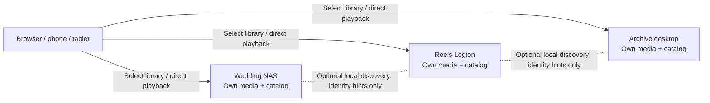

# Independent VidStream libraries

**Main 1.9.0 is the official release and includes Nodes.** The reviewed node checkpoint was merged into main at the user's request, preserving history. **VidStream-node** remains for isolated future experiments, not as a prerequisite for connecting libraries. The former Dev/Design branches are retired. This remains downloadable, self-hosted software serving your own locally available media, without a central VidStream cloud, upload service or account provider.

## How it works

Run the same VidStream app on each machine. Each instance owns its media folder, database, history, previews and sign-in. Video enhancement processing has been removed in 1.10.0; prepare finished media outside VidStream. A small directory of connections lets you select another instance from **Switch library** in the top center. The browser opens that server directly, and its video streams directly to the browser. Your starting machine does not relay everyone else's video traffic.



There is no required master/child distinction. Your always-on NAS can be your usual starting library and hold your connection list. A browser-only return link follows you to another server, including its sign-in screen. It carries only an origin in a URL fragment; it does not copy a server directory, credentials, settings or authentication. Incoming return addresses are unverified, clearly show their host, and stay temporary in that browser tab/session. They become persistent browser bookmarks only when you explicitly choose **Remember this return address**. **Make this my starting library** explicitly selects the current instance. Each server has its own saved connection list. You can make additional connections there, or return to your starting library to choose another machine.

This combines access to several libraries. It does **not** combine disks into a single filesystem, distribute files automatically, deduplicate across machines, create one global catalog, synchronize history, or offload enhancement jobs. A sleeping/offline machine takes only its own media offline. Saved connections are retained. Each machine still needs enough local space for its own previews and catalog. Historical processing files are retained but are not executed.

For your equipment, a practical first setup is:

| Machine | Example role |
| --- | --- |
| Synology NAS / 40 TB | Always-on starting library, wedding/personal archive |
| Legion / 4 TB NVMe | Reels or active collection; prepared media from external tools |
| Small desktop / SSD + HDD | Separate archive library; data/cache on local storage |
| MacBook / limited free space | Viewer/control device, or a smaller portable library |
| Other portable devices | Optional independent libraries while awake and reachable |

These are organizational examples, not a requirement to move any files. Kubernetes is unnecessary for this arrangement; its local volumes remain bound to their storage node. A shared writable SQLite volume is specifically not a substitute for independent instances. [Kubernetes local volumes](https://kubernetes.io/docs/concepts/storage/volumes/#local)

## Start with two machines

1. Install/run this branch on each machine using its own media folder and its own persistent data/cache volumes. Complete owner setup or use that instance's configured sign-in.
2. Open each machine's address from the browser/device you will actually use. For example, a NAS at `http://192.168.1.50/` and a Legion at `http://192.168.1.60/`. These are examples; use your real addresses. A DHCP reservation or stable local DNS name helps keep them consistent.
3. On each instance, open **Settings → Nodes**. Set **Library name** and **This library address** to the address other devices can open. Save it. A Docker container's private bridge address, `host.docker.internal`, or `localhost` is not a general LAN address for your phone.
4. On your starting instance, enter the other machine under **Other library address** → **Check library**. Review its name/address/identity, then **Add to switcher**.
5. Use **Switch library** in the top center. Sign in on the destination when requested. Signing in to one instance does not grant access to another. The browser can remember each destination's ordinary session.

The saved directory and node management are owner-only in this release. Guest Settings shows Nodes with a sign-in explanation instead of hiding the category. A discovered or saved connection never bypasses the destination's own media access rules. There is no password field for joining because the app does not store another machine's password; sign-in happens on the destination itself.

If Nodes seems missing after rebuilding Docker, reload the browser's gallery home page. An open tab keeps its already-loaded JavaScript. In the reported case, a forced reload made Nodes appear. Settings now shows the running version/address, owner/guest state and **Nodes included**. Versioned asset URLs refresh the scripts on a new page load. An obsolete media link also now preserves the authenticated owner role instead of hiding owner settings. See the [branch comparison and update guide](BRANCHES.md).

Keep every instance's data volume independent. Git source can be the same everywhere. Do **not** clone a live node's database/security files/session secret to create another node: that copies identity and security state. A fresh installation creates its own random persistent node ID. To move one existing node to replacement hardware, stop it and move its complete state deliberately; do not run two copies of that identity simultaneously.

Removing a connection removes only a directory entry. It does not delete media, previews, jobs, credentials or databases on either machine.

## Download and run official main

For an existing checkout, save local source edits first. Keep `.env`, media mounts and persistent volumes in place. Before the first 1.9 recreation, follow [storage upgrade steps](BRANCHES.md#retain-existing-storage-before-rebuilding), especially retaining an old `./originals` archive bind.

```sh
git fetch origin
git switch main
git pull --ff-only
docker compose up -d --build
```

- `git fetch origin` downloads Git history and branch references. It does not change working files, media, configuration or Docker data.
- `git switch main` selects official main and updates tracked source files. It preserves ignored media/configuration and Docker volumes and refuses conflicting local edits.
- `git pull --ff-only` updates this selected branch only if no merge is needed. It does not discard local changes or remove media/configuration/volumes.
- `docker compose up -d --build` rebuilds and starts/recreates this machine's application in the background. It retains named volumes and uses the explicitly configured media/archive mounts. Include an existing local override in the file list; the new base file alone no longer selects the former host media/originals paths. It does not install or update another machine.

For a new machine with Git/Docker already installed, choose a parent folder for the software:

```sh
git clone --branch main https://github.com/5u8han/VidStream.git
cd VidStream
cp .env.example .env
```

`git clone --branch main` creates a new software checkout of official main; it downloads no personal media or another node's runtime state. `cd VidStream` enters that new folder. `cp .env.example .env` creates a local configuration file from defaults; use it only in this new checkout, because it would replace an existing `.env`. Set `STREAM_MEDIA_PATH` to that machine's existing media folder and enable the commented read-only media bind in Compose, as shown in the [Docker quick start](../README.md#quick-start-docker), before running the Docker start command above. No media directory layout is bundled in the repository. Without an enabled media mount, the app has an empty library. New installs use a separate `stream-originals` volume for publication archives. Generate/retain separate security state on each machine. PowerShell users can use `Copy-Item .env.example .env` instead; it likewise copies defaults and must not overwrite an existing configured file.

To verify the source selected on a machine:

```sh
git branch --show-current
docker compose exec stream node -p "require('./package.json').version"
```

`git branch --show-current` prints the active local branch. `docker compose exec stream node -p "require('./package.json').version"` reads the version inside the running container without changing files; expect `1.10.0` on official main. A Docker rebuild is required for its existing container to use changed source; reload the browser afterward. For a native installation, `node -p "require('./package.json').version"` reads the checkout's version without starting the app or changing files. The new node settings use existing SQLite settings, without a catalog schema migration. Changing server address/origin can require signing in again; do not remove data or reset security files to resolve that.

## Optional discovery

**Find nearby libraries** is off by default. Enable it in **Settings → Nodes** on the participating instances after saving a reachable address. When supported by the network, nearby instances appear as **unverified** suggestions; check one before saving it. This avoids silently trusting a machine just because it broadcasts a familiar name.

VidStream LAN discovery is a small application-specific IPv4 multicast protocol, not Synology's proprietary finder protocol or mDNS. It uses group `239.255.86.83`, UDP `45873`, multicast TTL 1, a small initial query/announcement, and announcements every 30 seconds. Packets contain only protocol/kind, node ID, display name, HTTP/HTTPS scheme and port. No filenames, counts, paths, credentials or complete configuration are broadcast. Nearby hints expire after 90 seconds; saved connections remain.

Listening does not require scanning the whole network or polling every possible IP address. Normal saved-peer checks read a small fixed identity endpoint, at most three in flight, about once per minute. Each check has a three-second timeout and an 8 KB response limit. The directory supports up to 64 saved peers. It does not run work across the media catalog.

Multicast may be blocked by OS local-network permission, Wi-Fi client isolation, VLAN boundaries, a firewall, VPN routing or Docker networking. A local test on this development Mac returned `EHOSTUNREACH` when sending multicast; the application now reports that network-send failure instead of claiming discovery is working. Do not disable a firewall to make this feature work. Manual connections need only the instance's normal HTTP/HTTPS access and remain available when discovery fails.

Automatic candidates use the packet source IPv4 address plus declared scheme/port. A certificate issued only to a hostname will not validate against that raw IP: enter its certificate-valid HTTPS hostname manually. Reverse proxies using a subpath are not supported by this revision; give each library its own origin/root address. Viewer devices themselves must be able to reach the saved URL, even if two servers can reach each other.

## Docker, NAS and native networking

The standard Compose setup publishes host HTTP port **80** to fixed container port **4000**. `STREAM_HTTP_PORT` selects another host port when needed. The public address can omit `:80`; it must still resolve on the viewer's network. `http://submac.local/` may work where the short name `submac` does not. A real TLS proxy is required for HTTPS/443. Update saved self/peer URLs if the public port changes. This published-port setup is the portable baseline for NAS, Linux and Docker Desktop. Manual connections work independently of multicast. Docker Desktop's internal bridge/container IPs are generally not reachable directly from a LAN browser. [Docker Desktop networking](https://docs.docker.com/desktop/features/networking/networking-how-tos/)

For a **Linux Docker Engine** host where you want LAN multicast, an optional overlay uses host networking. Use a recent Compose version that understands `!reset`. First inspect the configuration:

```sh
docker compose -f docker-compose.yml -f docker-compose.nodes-host.yml config --quiet
docker compose -f docker-compose.yml -f docker-compose.nodes-host.yml up -d --build
```

`config --quiet` validates the combined Compose files without starting or changing containers. `up -d --build` applies the Linux host-network overlay, rebuilds and starts/recreates VidStream. This changes network isolation: HTTP and discovery use the host's ports directly and the overlay clears port publishing. In that mode the overlay sets the app's listening port from `STREAM_HTTP_PORT` (80 by default); choose an available permitted port if necessary. Existing media mounts and data/cache volumes remain inherited from the base file; it does not delete them. An occupied host port must be resolved before starting. Do not use this overlay merely for manual connections.

On Docker Desktop, host networking is an opt-in feature from version 4.34 with platform limitations. Multicast behavior still needs testing there; the Linux overlay is not a promise of automatic discovery on macOS/Windows. On Synology, availability depends on its container tooling/network mode; start with published HTTP and manual connections. Native VidStream can use the host network directly; its launcher must have **Allow devices on the local network to connect** enabled. The app cannot grant OS/VM/router permissions from its web menu. [Docker host networking](https://docs.docker.com/engine/network/drivers/host/), [Compose merge/reset behavior](https://docs.docker.com/reference/compose-file/merge/)

## Access, persistence and failure behavior

- Each instance retains independent sign-in. New session cookies and tokens are scoped to the persistent node identity so two instances on one hostname with different ports can coexist. Older sessions can migrate until sign-out; logout clears that instance's new cookie and the legacy cookie. Cookies are not generally isolated by port, so this application scoping matters. [HTTP cookie isolation](https://www.rfc-editor.org/rfc/rfc6265.html#section-8.5)
- The public identity endpoint intentionally reveals only product/protocol, random node ID and chosen name; no directory or media is exposed through it. Choose a generic name if even the collection theme is private. Unconfigured instances do not advertise and refuse identity checks until owner setup.
- Saved identity is pinned. If an address later presents another node ID, it is marked **Identity changed** and the switcher blocks navigation pending review. An address/name/UUID is not cryptographic proof against an attacker on unencrypted HTTP; use your trusted LAN or valid HTTPS/VPN for remote access. No certificate validation is bypassed.
- Discovery never imports secrets or grants access. Manual identity checks accept root HTTP(S) origins only, reject embedded credentials/paths/query/fragment and reserved metadata destinations, pin DNS resolution for the socket, do not follow redirects, and do not forward cookies or authorization.
- Saved settings/peers live in this instance's durable data store. Browser return addresses are separate: navigation fragments remain temporary/unverified, and persistence requires an explicit remember action. Sleep/outage retains saved entries; removing one never removes media. Replacing an address deliberately requires removing/rechecking the old connection.
- For shared viewing away from home, every selected instance needs a browser-reachable route. A VPN or your existing per-node HTTPS reverse proxy may provide that; automatic discovery remains local. There is no added central tunnel/relay service.

## Validation

The `1.9.0-node.2` consolidation update passed 132 unit/integration tests, 28 common generated-media browser checks and 21 multi-server browser checks with zero page errors. New cases verify loaded build/version/address, owner Nodes on obsolete media URLs, and an explanatory guest Nodes category without private directory requests or access. That tested checkpoint is now included in official main. Current release verification is recorded in the changelog.

Historical `1.9.0-node.1` validation on November 2, 2026: JavaScript syntax checks and all 128 unit/integration tests passed. All 26 existing player/design browser checks and 17 multi-server browser checks passed with zero page errors. The Linux host-network Compose overlay parsed successfully and retained the original media/data/cache/archive mounts. No Docker image was built or deployed during that historical test run. A later `1.9.0-node.2` local deployment was separately verified; it does not establish physical multi-machine discovery. The actual-LAN smoke check on this Mac failed with multicast send `EHOSTUNREACH`; this network/OS limitation is surfaced in the app. Physical NAS/Legion discovery and Docker Desktop multicast remain deployment checks, not claimed successes.

The isolated multi-server Chromium test starts independent temporary runtimes with generated photo/video media. It verifies manual joining, direct-origin playback, independent logins on one hostname, the locked destination/return link, outage/restart recovery, mobile layout, removal without media deletion, and a replacement server at the same address with a different identity. It does not touch personal media, real `.env`, persistent app data or Docker volumes.

```sh
npm run check
npm test
npm run test:browser
npm run test:nodes
npm run test:node-lan
```

- `npm run check` parses project JavaScript for syntax errors.
- `npm test` runs unit/integration checks, including discovery parsing, address policy, bounded network probes, durable identity and authentication isolation, using temporary/fake fixtures.
- `npm run test:browser` starts the existing isolated generated-media Chromium regression checks and removes only their temporary fixture data afterward.
- `npm run test:nodes` starts the isolated multi-server Chromium checks described above, stops its own servers, and removes only their temporary fixtures.
- `npm run test:node-lan` is an optional real-network check. It sends a handful of generated discovery-test announcements and waits up to eight seconds for two temporary listeners to see each other, then closes them. It uses no media or application state. Run this only when testing local multicast; it is intentionally separate from CI because OS/network permission varies.

FFmpeg and the existing Playwright development dependency/browser are needed for browser checks. Passing same-host checks does not establish multicast behavior across physical machines, across routers/VLANs, on Synology, or in Docker Desktop. Validate the first two real machines before expanding the directory.
